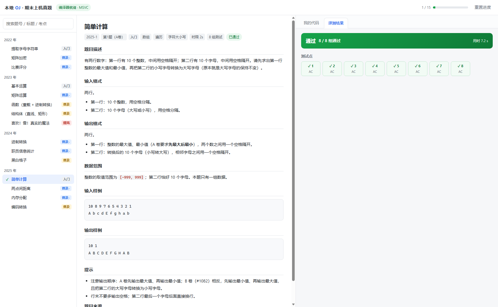
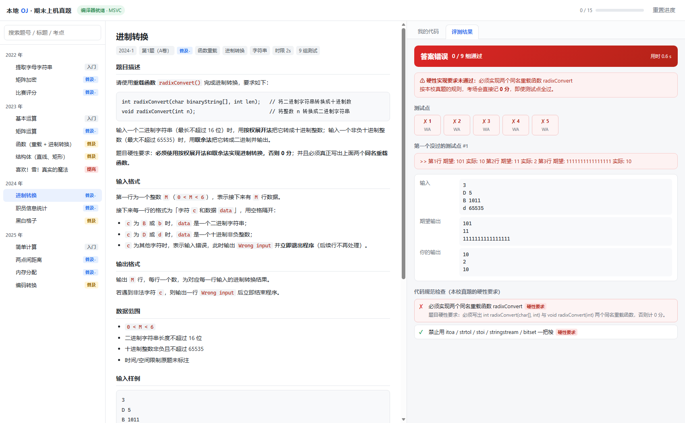

# 本地 OJ · 期末上机真题

把 2022–2025 四套上机真题（15 道正题，附加题按要求排除）做成了一个能在本机跑的判题网站：
浏览器里写 C++ → 点「提交评测」→ 真编译、真跑测试点、真判分，还能检查本校真题的「硬性实现要求」
（必须结构体 / 必须函数重载 / 禁止 STL 之类），违反就按考场规则提示「记 0 分」。

## 一、怎么跑

双击 **`oj/start.bat`**（或者在本目录执行 `python -X utf8 server.py`）。

- 会自动挑一个可用端口（默认从 18080 起试），并自动打开浏览器；
- 黑窗口关掉 = 服务停止；
- 想固定端口：`start.bat --port 18080`；不想自动开浏览器：`start.bat --no-browser`。

需要的东西：Python 3（本机已装 3.11）＋ 一个 C++ 编译器。本机没有 g++，**用 MSVC**：
脚本会自动通过 `vswhere` 找到 `vcvars64.bat`，第二次起编译环境会缓存到 `oj/.cache/toolchain.json`，
所以第一次启动慢约 2 秒，之后每次编译 ~2 秒。想指定别的 vcvars：设环境变量 `OJ_VCVARS`。

## 二、长什么样

| 做对一题 | 提交没通过 |
|---|---|
|  |  |

左边是题目列表和进度，中间是题面，右边是代码和评测结果。右图是故意用「硬编码答案」提交 2024-1 的结果：
逐测试点 ✗、第一个失败点的输入/期望/实际三栏对照，以及红字「硬性实现要求未通过 → 考场记 0 分」。

## 三、有哪些题

| id | 题目 | 难度 | 测试点 | 来源 |
|---|---|---|---|---|
| 2022-1 | 提取字母字符串 | 入门 | 8 | 2022 年 C++ 上册上机考试 · B卷 第1题 · OJ #264 |
| 2022-2 | 矩阵加密 | 普及- | 8 | 2022 年 C++ 上册上机考试 · B卷 第2题 |
| 2022-3 | 比赛评分 | 普及- | 8 | 2022 年 C++ 上册上机考试 · B卷 第3题 · OJ #268 |
| 2023-1 | 基本运算 | 入门 | 8 | 2023 上机考试真题 · 第1题 A卷 · OJ #551（B 卷 #552） |
| 2023-2 | 矩阵运算 | 普及- | 8 | 2023 上机考试真题 · 第2题 A卷 · OJ #553（B 卷 #554） |
| 2023-3 | 函数（重载 + 进制转换） | 普及 | 10 | 2023 上机考试真题 · 第3题 A卷 · OJ #555（B 卷 #556） |
| 2023-4 | 结构体（直线、矩形） | 普及 | 9 | 2023 上机考试真题 · 第4题 A卷 · OJ #557（B 卷 #558） |
| 2023-5 | 喜欢！雪！真实的魔法 | 提高 | 8 | 2023 上机考试真题 · 压轴题 · OJ #560 |
| 2024-1 | 进制转换 | 普及- | 9 | 2024 2-1 上机考试真题 · 第1题 A卷 · OJ #843 |
| 2024-2 | 职员信息统计 | 普及- | 8 | 2024 2-1 上机考试真题 · 第2题 A卷 · OJ #845 |
| 2024-3 | 黑白格子 | 普及 | 9 | 2024 2-1 上机考试真题 · 第3题 A卷 · OJ #847 |
| 2025-1 | 简单计算 | 入门 | 8 | 2025 期末上机真题 · 第一题 A卷 · NKU-OJ #1081 |
| 2025-2 | 两点间距离 | 普及- | 8 | 2025 期末上机真题 · 第二题 A卷 · NKU-OJ #1083 |
| 2025-3 | 内存分配 | 普及- | 8 | 2025 期末上机真题 · 第三题 A卷 · NKU-OJ #1087 |
| 2025-4 | 编码转换 | 普及 | 8 | 2025 期末上机真题 · 第一题 A卷 · NKU-OJ #1091 |

题面统一按 **A 卷** 写；**B 卷的差异写在每题「提示」里**（输出顺序相反、`0` 换 `-`/`#`、
求最大距离、大写转小写等），做 A 卷顺手把 B 卷也过一遍最划算。

附加题（2022 子矩形计数、2024 博丽的降雪结界、2025 联合）按你的要求**没有收进来**。

## 四、界面怎么用

- **左栏**：按年份分组的题目列表，带难度标签；做过的题目名前面会出现 ✓，右上角是 0/15 进度条；顶部搜索框可以按题号 / 标题 / 考点过滤。
- **中间**：题面（描述、输入输出格式、数据范围、样例、提示、题目来源）。
- **右侧**：「我的代码」写代码（带行号，Tab 缩进 4 格，`Ctrl+Enter` 提交）；「评测结果」看判题结果。
  - 代码、自测输入、通过状态都存在浏览器 `localStorage` 里，关掉页面不丢；「清空」只清当前题的代码。
  - 「看参考解」是弹窗，**先自己做，卡住了再看**。
  - 「自测运行」：自己填输入，只看输出对不对，不判分、不记提交。
- **评测结果**：绿色 `通过 8/8`；写错是 `答案错误`，并给出**第一个没过的测试点**的「输入 / 期望输出 / 你的输出」三栏对照；
  编译不过给 `编译错误` + 编译器原文；死循环给 `超时`；崩溃/非零退出给 `运行错误`。

## 五、判题规则（尽量贴近本校考场）

1. **比对方式**：逐行比对，忽略行尾空白（所以「行尾不要多空格」这件事在本地不会被误判，但考场会，题面里都写了）。
   2023-5 这种浮点题按 `eps=1e-5` 比较。
2. **代码规范检查**（`problems/*.json` 的 `checks`）：
   - `require`：必须出现的写法，比如必须定义两个同名重载函数、必须有 `struct`；
   - `forbid`：禁止的写法，比如 2022 三题禁止 STL（`algorithm` / `vector` / `sort`）、
     2023-3 禁止 `%x` 格式化与 `itoa` / `sprintf` / `stringstream` / `bitset`、2024-1 禁止 `strtol` / `stoi`。
   - 标了 `fatal` 的检查没过，界面会红字提示「按本校真题的规则，考场会直接记 0 分」，**即使测试点全过**。
3. **时限**：每题 2 秒（与 OJ 的 1000ms 放宽一倍，给慢机器留余量）；内存不设限。
4. **提前结束**：连续失败满 5 组就停，省时间。
5. 编译参数：`cl /EHsc /O2 /std:c++17 /utf-8`（有 g++ 的环境会改用 `g++ -O2 -std=c++17`）。
   `/utf-8` 是必须的，不然源码里的中文注释会被按 GBK 解析直接编译失败。

## 六、目录结构

```
oj/
├─ start.bat            双击启动（GBK 编码，中文提示不乱码）
├─ server.py            本地 HTTP 服务（只绑 127.0.0.1，不出网）
├─ oj.html              单文件前端（无任何外部依赖，离线可用）
├─ engine.py            读题 / 比对 / 代码规范检查 / 判题总流程
├─ judge.py             找编译器、编译、运行（带超时）
├─ build.bat            MSVC 编译兜底脚本
├─ CONTRACT.md          出题数据契约（想加题先看这个）
├─ problems/<id>.json   题面 + 样例 + 时限 + checks
├─ solutions/<id>.cpp   参考解（界面「看参考解」用的就是它）
├─ testdata/<id>/N.in   每个测试点的输入 / 期望输出（.out 全部由参考解生成）
│                N.out
├─ tools/gen_expected.py  用参考解重新生成 .out
├─ tools/check_problem.py 自检一道题（或 --all）：字段、样例一致性、测试点连续性、参考解能否 AC
├─ tools/run_cpp.py       命令行编译+运行单文件，方便调试
├─ submissions.jsonl    提交记录（JSON Lines，一行一次）
└─ .cache/toolchain.json  MSVC 环境缓存（可删，删了下次启动重新探测）
```

## 七、加题 / 改题

看 `CONTRACT.md`，步骤是：

1. 写 `problems/<id>.json`（`statement` 里必须有 `### 题目描述 / ### 输入格式 / ### 输出格式 / ### 数据范围 / ### 输入样例 / ### 输出样例 / ### 提示` 这些小标题）；
2. 放 `solutions/<id>.cpp` 参考解；
3. 放 `testdata/<id>/1.in`，然后 `python -X utf8 tools/gen_expected.py <id>` 自动生成 `.out`；
   注意 `1.in` / `1.out` 必须和 json 里 `samples[0]` 逐字符一致；
4. `python -X utf8 tools/check_problem.py <id>` 自检，全绿即可在界面里看到。

## 八、常见问题

- **报 `error C2131: 表达式的计算结果不是常数`（编译错误）**：写了 `int a[m][m];` 这种**运行时大小的数组**。
  MSVC 不支持变长数组（洛谷/学校的 g++ 会当成扩展放行，所以同一份代码可能"那边能过、这边 CE"）。
  按题意上限开常量大小即可：`const int N = 105; int a[N][N];`，或用 `new`/`vector` 动态开。
- **提示找不到编译器**：装 MSVC（Visual Studio 的「使用 C++ 的桌面开发」）或 MinGW-w64（`g++` 进 PATH）；
  也能用 `set OJ_VCVARS=你的\vcvars64.bat` 指定。
- **端口被占**：脚本会自动往后找一个；也可以 `start.bat --port 18081`。
- **第一次提交要等 2～3 秒**：编译本身要时间，属正常；同一份源码重复提交不会更快（每次都是干净编译）。
- **提交记录想清空**：删掉 `oj/submissions.jsonl` 即可；界面上的 ✓ 存在浏览器里，点「重置进度」清。
- **换电脑**：整个 `oj/` 目录拷走就行，`.cache` 和 `submissions.jsonl` 可以删掉。目标机器要有 Python 3 和 C++ 编译器。

---

配套的刷题建议在上一级目录的 [洛谷刷题清单.md](../洛谷刷题清单.md)：按考点把 15 道真题和洛谷上的对应练习对上了。
